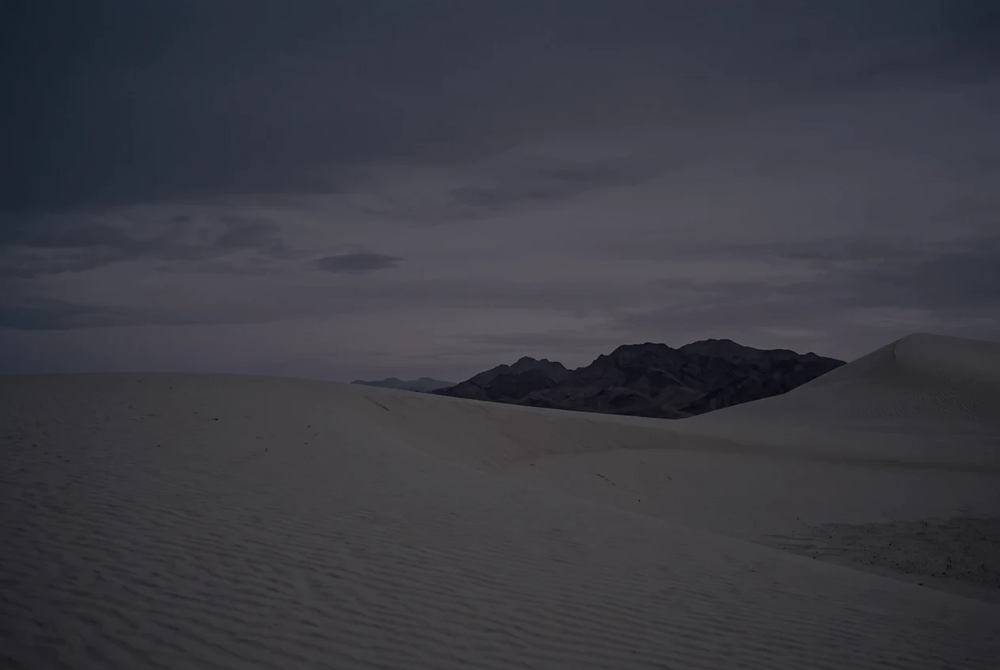

  

<h1 align="center">Sreon 1.1</h1>

  <strong>Less browser. More possibility.</strong>

  A browser rebuilt from scratch with a homemade programming language. 
  A quieter place to explore, create, and make your own.

  <a href="https://opensreon.com/#download"><strong>Download Sreon</strong></a>
  &nbsp;·&nbsp;
  <a href="https://opensreon.com">Explore Sreon</a>

---

## A different browser starts with a different language.

Meet **SPRFST** — a homemade programming language created specifically for building Sreon.

With version **1.1**, Sreon has been completely remade using this language. Its settings, new tab, sidebar, and buttons are written in SPRFST, rather than JavaScript or an off-the-shelf interface toolkit.

**SPRFST isn’t an extra feature attached to the browser. It’s the foundation of its interface.**

And that foundation is yours to explore. Read the code, change how things work, and use the same language to create your own programs and apps.

**Don’t just use your browser. Make it yours.**

---

## Your own little universe.

*Deep-space colors. Quiet landscapes. Room to think.*

Sreon’s **Celestial theme** brings a calmer feel to your everyday browsing: dark surfaces, delicate borders, and an interface that gives your content room.

Your new tab becomes a small desktop, complete with:

- A clock, status strip, and search box.
- A dock for saved apps and built-in tools.
- Activity dots showing which apps are open.
- Quick access to **Studio, Guidebook, Shield, and Settings**.
- A sidebar you can show or hide from the toolbar.

Less visual noise. More space for what matters to you.

---

## A new beginning, every time you launch.

Sreon 1.1 welcomes you with an animated celestial splash screen.

Stars fill the background. A ring draws into view. A moon follows its orbit, and the Sreon wordmark appears in stages.

Live boot updates show what’s happening while the browser prepares. When it’s ready, the splash closes and your browser window gently fades in.

A launch watchdog helps keep the splash from getting stuck.

**A small moment of space before you explore the web.**

---

## From browsing to building.

### Meet Sreon Studio.

An idea shouldn’t have to stay an idea.

With **Studio**, you can write SPRFST programs and build your own interactive apps inside Sreon.

Version 1.1 introduces **live, clickable app previews**. Instead of only seeing text output, you can interact with what you’ve made. Each click replays your program so you can see how it responds.

- Start with the new **app** starter button.
- Write your program in SPRFST.
- Supply input through Studio’s **Input** box.
- Click through your app preview.
- Experiment, adjust, and make something personal.

**The language that builds Sreon can help you build something of your own.**

### A guide beside you.

The built-in **Guidebook** now spans **32 chapters**, including two new chapters dedicated to:

- **Asking questions** — getting input into your programs.
- **Making an app** — turning your code into an interactive experience.

Start small. Learn as you go.

---

## A smoother path from thought to action.

Sreon is designed to keep your tools close and your interface focused.

Your dock brings apps and built-in tools together. The sidebar moves out of the way when you need more space. Studio lets you test interactions without leaving your creative workspace.

**Less switching around. More getting on with it.**

Actual performance varies by device, network, and workload.

---

## What’s new in Sreon 1.1?

### A new foundation
The browser interface has been rebuilt in **SPRFST**, Sreon’s custom-made programming language.

### A celestial welcome
An animated splash screen, live boot stages, a launch watchdog, and a smooth window fade-in.

### A desktop-style new tab
A clock, search, status strip, and app dock with open-app indicators.

### Apps you can interact with
Clickable Studio previews, a new app starter, and desktop-app project scaffolding through the SPRFST CLI.

### Better ways to ask and listen
New functions for numbers, integers, yes/no answers, and reading all input:

- `io.ask_num`
- `io.ask_int`
- `io.ask_yes`
- `io.read_all`

Long input lines are preserved, and Studio’s Input box feeds your program directly.

### More to discover
A **32-chapter Guidebook**, expanded app documentation, and updated tests.

### A new identity
The **Orbit mark** — a glowing planet, tilted ring, and moon — alongside refreshed app icons.

---

## Get Sreon 1.1

**Your next chapter starts here.**

| Platform | Availability |
| :--- | :--- |
| **macOS** | [Download Sreon](https://opensreon.com/#download) |
| **Windows** | Coming soon |
| **Linux** | Coming soon |

### Install on Mac

1. Download **SREONBROWSER.dmg** from the official Sreon website.
2. Open the downloaded disk image.
3. Drag **Sreon** into your **Applications** folder.
4. Eject the disk image, then open Sreon from Applications.

<strong>Need help with a macOS verification warning?</strong>

If macOS says **“Apple cannot check it for malicious software”** or **“developer cannot be verified,”** it means Apple hasn’t verified the app. This is not by itself proof of malware, but it is not a guarantee of safety.

**Only continue if you downloaded Sreon from the official website and trust the app:**

1. Try opening Sreon.
2. Go to **System Settings → Privacy & Security**.
3. Scroll down to the **Security** section.
4. Find the message about Sreon being blocked.
5. Click **Open Anyway**, authenticate if asked, and confirm **Open**.

If Open Anyway isn’t shown, try opening Sreon again and check the settings. On a managed Mac, contact your administrator.

**Do not bypass an actual malware warning.** If macOS says the app **“will damage your computer”** or **“contains malware,”** stop and don’t open it. Don’t disable macOS security protections.

---

  

  <strong>A browser of your own. A language of its own.</strong> 
  Explore the web. Learn something new. Build what comes next.

  <a href="https://opensreon.com/#download"><strong>Make space for Sreon →</strong></a>

